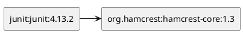

# Практическая работа № 2. Вариант 6

Дисциплина: «Конфигурационное управление». Группа УНБО-06-25.
Автор: Городков Степан.

Инструмент анализа и визуализации зависимостей Java (Maven).
Реализация на Python 3.10+; только стандартная библиотека.

## Возможности

Реализованы CSV-конфигурация и прямое чтение XML POM по HTTP(S).
Этап 2 выводил все прямые зависимости, включая test/provided и optional.
Программа строит граф обязательных runtime-зависимостей
пакета как внешней библиотеки: области compile/runtime, без optional.
Граф сохраняет явно объявленные версии, не выполняет mediation Maven.
Поддержаны свойства, parent POM, dependencyManagement, импорт BOM
и исключения зависимостей на путях. Обработка parent/BOM итеративная.
Кеш находится только в памяти. Maven и сторонние библиотеки не вызываются.
Финальная версия создает PlantUML и PNG, по настройке выводит ASCII-дерево.
Вывод параметров, прямых зависимостей и порядка загрузки доступен в коммитах
этапов 1, 2 и 4 соответственно, как требуют пункты «только для этого этапа».

## Запуск и проверка

Сборка не требуется. Установка зависимостей Python не требуется.
Нужны Python 3.10+ и, для PNG, Java 11+ с внешним PlantUML JAR.
Проверено на Python 3.12, Java 21 и PlantUML 1.2025.2.
PlantUML использует встроенный Smetana; Graphviz не требуется.
Граф отрисовывается локально, без отправки на сервер визуализации.

Установить Python: <https://www.python.org/downloads/>.
Скачать PlantUML: <https://plantuml.com/download>.
JAR хранится вне репозитория. Указать его путь перед запуском.

PowerShell (путь заменить на фактическое расположение JAR):

```powershell
$env:PLANTUML_JAR = 'C:\Tools\plantuml.jar'
python -B -m src examples/junit.csv
```

Linux/macOS:

```sh
export PLANTUML_JAR="$HOME/tools/plantuml.jar"
python3 -B -m src examples/junit.csv
```

Java берется из `JAVA_HOME/bin/java` либо из PATH. `PLANTUML_JAR` и
`JAVA_HOME` задают расположение установленных инструментов, а все семь
пользовательских настроек анализа находятся только в CSV.
Единственный аргумент CLI - путь к CSV. Справка: `python -m src --help`.
Команды ниже выполняются из корня репозитория.

```console
python -B -m src examples/junit.csv
python -B -m unittest discover -s tests -v
```

Windows: `run.bat examples\junit.csv`. Если Python отсутствует в PATH,
укажите полный путь к интерпретатору в переменной окружения `PYTHON`.

## Формат настроек

CSV в UTF-8, заголовок `key,value`, разделитель запятая, все семь ключей
обязательны. Значения с запятой заключаются в двойные кавычки.
Относительные пути отсчитываются от каталога CSV, не от текущего каталога.

| Ключ | Значение |
| --- | --- |
| package | Maven `groupId:artifactId`; в тестовом режиме одна буква A-Z |
| repository | URL HTTP(S); в тестовом режиме путь к существующему файлу |
| test_mode | `true` или `false` |
| version | Фиксированная версия; без диапазонов, SNAPSHOT, LATEST, RELEASE |
| output | Путь выходного файла `.png` |
| ascii_tree | `true` или `false` |
| max_depth | Целое число >= 0; глубина корня равна 0 |

Пример: `examples/junit.csv`. Ошибки выводятся в stderr; код завершения 1.
Ошибки аргументов командной строки дают код 2. Успешный запуск дает код 0.

## Функции

- `config.read_rows`: проверка структуры CSV и множества ключей.
- `config.boolean`, `depth`: преобразование логических значений и глубины.
- `config.check_coordinate`: проверка имени пакета и версии.
- `config.repository_path`, `repository_url`, `output_path`: URL и пути.
- `config.load_config`: сборка неизменяемого объекта `Config`.
- `__main__.main`: разбор пути CSV и обработка ошибок.
- `__main__.run`: анализ, необязательное ASCII-дерево и сохранение файлов.
- `maven.fetch_bytes`, `request_bytes`, `pom_url`: HTTP-загрузка и адрес POM.
- `maven.parent_coordinate`, `management_rows`, `bom_coordinates`:
  получение родителя и импортов BOM.
- `maven.assemble_model`: объединение модели POM.
- `MavenRepository.root`, `prerequisites`, `model`, `direct`:
  кеширование XML, разрешение моделей и получение прямых зависимостей.
- `pom.parse_xml`, `text`: чтение XML и элементов POM.
- `pom.expand`, `properties_for`: подстановка и наследование свойств.
- `pom.raw_dependency`, `resolve_row`, `dependency_key`, `dependency_name`:
  чтение, идентификация и проверка зависимости.
- `pom.make_dependency`: применение dependencyManagement и валидация.
- `Dependency.coordinate`: полные координаты зависимости.
- `test_repository.read_graph`, `TestRepository.direct`: локальный граф.
- `graph.excluded`, `runtime_dependencies`: области и исключения ребер.
- `graph.add_edge`, `build_graph`, `analyze`: построение графа очередью BFS.
- `order.reverse_edges`, `load_order`: обратные ребра и алгоритм Кана.
- `visualization.escape_label`, `to_plantuml`: экранирование и диаграмма.
- `visualization.java_command`, `render_png`: локальный вызов PlantUML.
- `visualization.save_visualization`: запись исходника и PNG.
- `visualization.node_marker`, `push_children`, `ascii_tree`:
  нерекурсивный вывод дерева, пометки cycle/shared/depth limit.

`Config`, `Dependency`, `PomModel`, `Graph` хранят данные; конструкторы
репозиториев задают источник и кеш. Все функции и методы снабжены docstring.

## Тестовый репозиторий

Формат: CSV UTF-8 с заголовком `package,dependencies`. В первом столбце
одна буква A-Z; во втором имена зависимостей через пробел. Для листа
второй столбец пуст. Каждый пакет должен быть описан ровно один раз.
Версия из конфигурации назначается всем пакетам тестового репозитория.

```csv
package,dependencies
A,B C
B,D
C,D
D,
```

```console
python -B -m src examples/diamond.csv
python -B -m src examples/cycle.csv
python -B -m src examples/chain.csv
python -B -m src examples/leaf.csv
```

Результаты: diamond содержит A->B, A->C, B->D, C->D; cycle сохраняет
A->B->C->A и завершается; chain при глубине 1 содержит только A->B;
leaf содержит только A. При глубине 0 получается только корень.
Узлы на границе глубины не раскрываются, их POM не запрашиваются.
Все ребра ориентированы от пакета к зависимости. Цикл не удаляется.
Тест на цепочку из 1501 узла подтверждает отсутствие рекурсивного обхода.

## Порядок загрузки и сравнение с Maven

На этапе 4 для diamond получается `D:1 -> B:1 -> C:1 -> A:1`.
Для chain при глубине 1: `B:1 -> A:1`; для leaf: `A:1`.
Для cycle выводится ошибка о невозможности порядка загрузки (код 1).
При ограничении глубины порядок относится только к построенному подграфу.
Корневой пакет включен последним. Используется алгоритм Кана, без рекурсии.

Фактическое сравнение выполнено 17.11.2026: Maven 3.9.9, Java 21,
maven-dependency-plugin 3.8.1. `examples/maven/pom.xml` используется только
для сравнения; основное приложение никогда его не читает и не запускает Maven.

```console
mvn -B -f examples/maven/pom.xml -Dmaven.artifact.threads=1 dependency:resolve
```

В кеше сравнения предварительно отсутствовали JAR двух проверяемых пакетов.
Из журнала Maven, в порядке начала запросов:

```text
Downloading .../junit/junit/4.13.2/junit-4.13.2.jar
Downloading .../org/hamcrest/hamcrest-core/1.3/hamcrest-core-1.3.jar
```

Порядок программы: `org.hamcrest:hamcrest-core:1.3 -> junit:junit:4.13.2`.
Множество пакетов совпадает, порядок отличается. Программа вычисляет порядок
готовности зависимостей (топологический). Maven может скачивать архив пакета
раньше архивов его зависимостей: скачивание файла не требует их готовности.
Кроме того, порядок сетевых запросов зависит от кеша и параллелизма.
Топологический порядок не заявляется копией порядка HTTP-запросов Maven.

## Три примера визуализации и сравнение

Все примеры ниже фактически запущены; PNG открыты и проверены.
Каждый запуск создает два файла в игнорируемом каталоге `generated/`:
одноименный `.png` и текстовый `.puml`. Исходник нужен для воспроизведения
диаграммы. Эти сгенерированные файлы не хранятся в Git.

```console
python -B -m src examples/junit.csv
python -B -m src examples/commons-text.csv
python -B -m src examples/slf4j-simple.csv
```

Фактический ASCII-вывод:

```text
junit:junit:4.13.2
`-- org.hamcrest:hamcrest-core:1.3

org.apache.commons:commons-text:1.10.0
`-- org.apache.commons:commons-lang3:3.12.0

org.slf4j:slf4j-simple:2.0.13
`-- org.slf4j:slf4j-api:2.0.13
```

Для JUnit получается следующий текст PlantUML:



Штатное средство сравнения - `maven-dependency-plugin:tree`, текст и DOT.
Версия 3.8.1 закреплена в `examples/maven/pom.xml`. Для JUnit:

```console
mvn -B -f examples/maven/pom.xml dependency:tree -Dscope=runtime
```

Для остальных примеров изменить свойства в командах (PowerShell):

```powershell
mvn -B -f examples/maven/pom.xml dependency:tree -Dscope=runtime `
  '-Dsample.group=org.apache.commons' '-Dsample.artifact=commons-text' `
  '-Dsample.version=1.10.0'
mvn -B -f examples/maven/pom.xml dependency:tree -Dscope=runtime `
  '-Dsample.group=org.slf4j' '-Dsample.artifact=slf4j-simple' `
  '-Dsample.version=2.0.13'
```

Для DOT добавить `-DoutputType=dot`; для сохранения -
`-DoutputFile=путь/за/пределами/репозитория/graph.dot`.
В примерах фактически получены следующие деревья Maven:

```text
practice:dependency-comparison:jar:1.0
\- junit:junit:jar:4.13.2:compile
   \- org.hamcrest:hamcrest-core:jar:1.3:compile

practice:dependency-comparison:jar:1.0
\- org.apache.commons:commons-text:jar:1.10.0:compile
   \- org.apache.commons:commons-lang3:jar:3.12.0:compile

practice:dependency-comparison:jar:1.0
\- org.slf4j:slf4j-simple:jar:2.0.13:compile
   \- org.slf4j:slf4j-api:jar:2.0.13:compile
```

После удаления вспомогательного корня `practice:dependency-comparison`
и служебных полей `jar`/`compile` узлы и ребра всех трех графов совпадают.
DOT подтверждает те же ориентированные ребра. Различается представление:
Maven выводит дерево/DOT, программа создает PlantUML/PNG и ASCII-дерево.

Пределы реализации: анализируется опубликованный POM фиксированной версии.
Не реализованы активация профилей Maven, разрешение диапазонов/SNAPSHOT,
relocation и выбор одной версии при конфликтах (dependency mediation).
Разные версии остаются разными узлами. Не выполняется сборка Java-пакетов.
Это может давать отличия для других пакетов; для трех проверенных выше
образцов различий в составе графа нет. `test`, `provided`, `system`
и optional исключаются из runtime-графа внешнего потребителя.
Усечение глубины намеренно может скрыть нижние уровни.

## Состав репозитория

| Путь | Назначение |
| --- | --- |
| README.md | Описание, настройки, функции, запуск и результаты сравнений |
| .gitignore | Исключение бинарников, архивов, кешей и результатов |
| run.bat | Скрипт запуска для Windows |
| src/ | Реализация CLI, POM, BFS, порядка и визуализации |
| tests/ | Автоматические тесты стандартного unittest |
| examples/*.csv | Семь конфигураций и четыре тестовых графа |
| examples/maven/pom.xml | Только воспроизводимое сравнение с Maven |

`requirements.txt` отсутствует намеренно: сторонних зависимостей Python нет.
Отчет размещен в этом README, отдельный отчет методичкой не требуется.

## История

- `stage-1`: CSV и вывод настроек, 7 тестов.
- `stage-2`: прямые зависимости и обработка POM.
- `stage-3`: BFS, глубина, циклы и локальные тестовые графы.
- `stage-4`: порядок загрузки и фактическое сравнение с Maven.
- `stage-5`: PlantUML, PNG, ASCII-дерево и три сравнения.

Для проверки отдельного этапа: `git checkout stage-1` (или другую метку).
Вернуться к последнему состоянию: `git checkout main`.
При переключении этапа действуют README и тесты именно этого коммита.
Сообщения коммитов оформлены по Conventional Commits со scope и описанием.

## Проверка ошибок

`tests/test_config.py` проверяет неверные значения всех семи параметров,
пропуск, дублирование и добавление ключей, пустые значения, структуру CSV,
отсутствие файла, нулевую глубину и диагностический вывод CLI.
Остальные тесты проверяют HTTP/POM, наследование и BOM, BFS, циклы,
исключения, топологический порядок, форматы и отказ внешнего рендерера.
Офлайн-тесты не требуют Java, PlantUML, Maven или соединения с интернетом.

Ограничения методички проверяются также статически: файл <=1000 строк,
строка Python <=80 символов, функция <=40 строк, аргументов <=7,
цикломатическая сложность <=10; документация через docstring.
Магические числа в сравнениях не используются. Проверены PEP8,
отсутствие бинарников/архивов/кешей в истории и чистое рабочее дерево.

## Источники форматов

- [Maven POM](https://maven.apache.org/pom.html)
- [Зависимости Maven](https://maven.apache.org/guides/introduction/introduction-to-dependency-mechanism.html)
- [PlantUML CLI](https://plantuml.com/command-line)
- [Conventional Commits](https://www.conventionalcommits.org/en/v1.0.0/)
